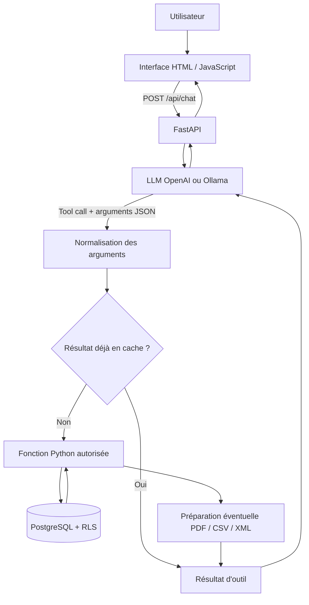

# Agent IA Financier — Documentation du projet

> **Statut :** documentation de préparation du dépôt. Le `server.py` V2.2 validé localement et les fichiers `static/` doivent encore être ajoutés depuis le poste de développement. Les fonctionnalités décrites correspondent à l'architecture discutée ; elles ne constituent pas une validation de déploiement.

## Objectif

Permettre à un prestataire d'interroger ses transactions financières en français, de consulter des indicateurs, de comparer des périodes et de préparer des exports PDF, CSV ou XML.

## Choix d'architecture

- **LLM** : OpenAI ou modèle local via Ollama, selon la configuration.
- **Tool Calling** : le modèle sélectionne des fonctions Python déclarées dans `TOOLS`. Il ne rédige pas lui-même les requêtes SQL.
- **FastAPI** : reçoit les demandes HTTP et expose les routes de l'application.
- **PostgreSQL** : conserve les transactions ; **RLS** limite les lignes accessibles par prestataire.
- **Python** : calcule les indicateurs et les comparaisons ; ReportLab produit le PDF.
- **Pas de RAG documentaire** dans cette version : pas de moteur de recherche de passages dans des documents.

## Fonctionnement

1. L'utilisateur saisit une question dans le navigateur.
2. Le frontend envoie la question à `POST /api/chat`.
3. FastAPI transmet la demande au LLM avec les descriptions des fonctions disponibles.
4. Le LLM propose un appel d'outil et des arguments JSON.
5. Le backend normalise certains arguments et contrôle l'exécution.
6. La fonction Python consulte PostgreSQL ou prépare un export.
7. Le résultat est renvoyé au LLM pour rédaction d'une réponse.
8. Si un export a été préparé, le frontend peut utiliser l'URL du document.

Voir [architecture](docs/ARCHITECTURE.md), [guide d'installation](docs/INSTALLATION.md), [API](docs/API.md), [tests](docs/TESTS.md), [sécurité](docs/SECURITE.md) et [évolution V2.1 → V2.2](docs/EVOLUTION.md).

## Diagramme principal



## Installation rapide

Voir les étapes détaillées dans `docs/INSTALLATION.md`. Les commandes ci-dessous supposent que le `server.py` V2.2 et le frontend sont présents.

```powershell
python -m venv .venv
.\.venv\Scripts\Activate.ps1
pip install -r requirements.txt
Copy-Item .env.example .env
# Modifier .env avec vos propres paramètres, sans le publier
# Démarrer le conteneur PostgreSQL déjà configuré :
docker start agent-ia-postgres
python -m uvicorn server:app --reload --port 8005
```

## Précautions avant publication

**Ne jamais pousser** `.env`, mots de passe, clés API, exports contenant des données réelles ou sauvegardes de base. Le paramètre `PRESTATAIRE_TEST_ID` n'est pas une authentification utilisateur. Les téléchargements de documents doivent être protégés avant un déploiement public.

## État du projet

- Architecture et documentation : préparées.
- Application locale : tests manuels rapportés, à reproduire et automatiser.
- Authentification multi-prestataire, autorisation des téléchargements, persistance des exports : à renforcer.
- Publication GitHub : à effectuer après ajout du code local et revue des secrets.
