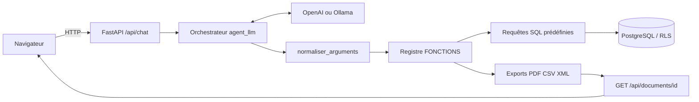
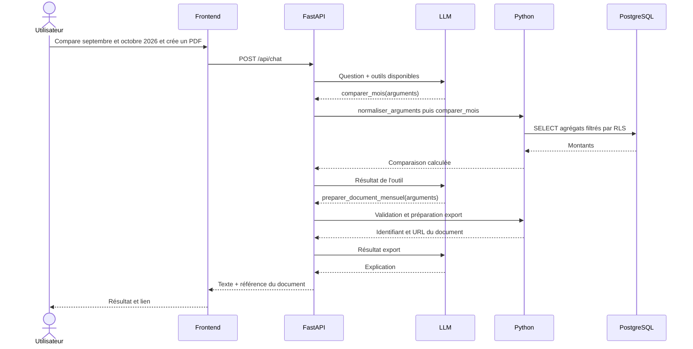

# Architecture technique

## Vue d'ensemble

## Séquence : comparaison et export

## Séparation des responsabilités

| Composant | Responsabilité | Ne doit pas faire |
|---|---|---|
| LLM | Interpréter la demande, proposer un outil, expliquer | Inventer les montants ou accéder directement à SQL |
| FastAPI | Exposer l'API et orchestrer | Remplacer les contrôles d'accès |
| Python | Valider, calculer, générer les documents | Faire confiance aveuglément aux arguments du modèle |
| PostgreSQL | Stocker les données et appliquer RLS | Déterminer l'intention en langage naturel |

## RAG ou Tool Calling ?

Cette version est fondée sur le **Tool Calling** : le LLM demande l'exécution de fonctions métier. Elle ne comprend pas de pipeline RAG documentaire (ingestion, indexation, récupération de passages, contexte documentaire). Une recherche vectorielle pourrait être ajoutée ultérieurement pour des contrats et factures.
