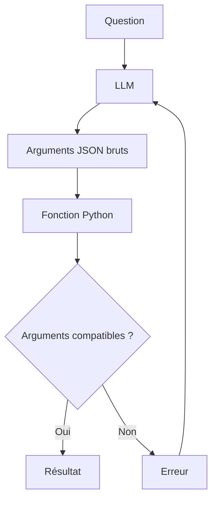
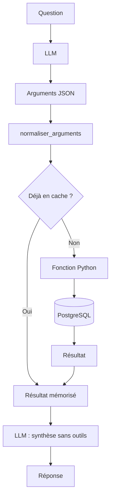

# Évolution des versions

## Approche initiale : détection d'intention par règles

Certaines premières approches utilisent des mots-clés (`if "solde" in question`). Ce mécanisme n'est **pas** une compréhension de la langue par un LLM.

## V2.1 : Tool Calling

Le modèle reçoit des définitions d'outils et peut sélectionner `comparer_mois`, `obtenir_kpi_mensuel`, `preparer_document_mensuel`, etc. Les arguments étaient parfois transmis tels quels à Python, entraînant des erreurs comme `annee` au lieu de `annee_1` et `annee_2`.

## V2.2 : orchestration renforcée

Ajout d'une normalisation partielle des paramètres, extraction de certains mois explicites, cache temporaire des résultats d'outils, réduction du nombre de tours et synthèse finale sans nouveaux outils.

### Limites

- La normalisation ne couvre pas toutes les formulations de dates.
- Le cache est temporaire, propre à une requête ; il ne garantit pas des résultats frais si les données changent pendant cette requête.
- Une synthèse finale n'est pas une preuve que tous les outils ont réussi.
- Des tests automatisés sont nécessaires.
